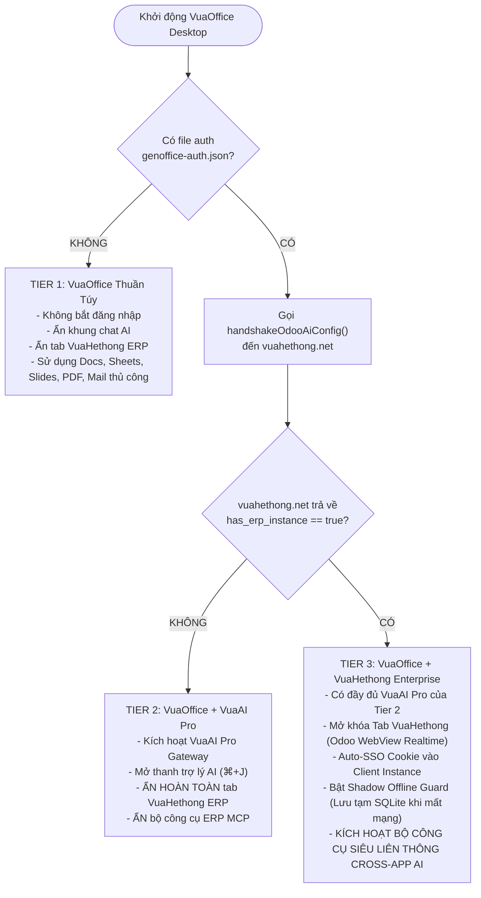

# KIẾN TRÚC TÍCH HỢP HỆ SINH THÁI VUAOFFICE & VUA-HỆ-THỐNG
## MA TRẬN 3 TẦNG NGƯỜI DÙNG, MÔ HÌNH WEBVIEW REALTIME & LIÊN THÔNG AI CROSS-APP

> **Mã tài liệu**: `360-ARCH-VUAOFFICE-3TIERS-HYBRID-ERP`  
> **Phiên bản kiến trúc**: `v4.0.0` (3-Tier Persona • Zero-Intrusion • Cross-App AI Automation)  
> **Tác giả**: 360 CORP Architecture Team  
> **Ngày chuẩn hoá**: 2026-11-10  
> **Nguyên tắc kỹ thuật**: Ponytail / YAGNI — Đơn giản nhất, tải nguyên bản WebView, không can thiệp lõi Odoo và VuaOffice.

---

## 1. Ma Trận 3 Tầng Người Dùng (3 User Personas / Tiers Matrix)

Để đảm bảo phần mềm phục vụ chính xác từ người dùng cá nhân phổ thông đến các tập đoàn sử dụng ERP quy mô lớn mà không làm phức tạp hóa ứng dụng, kiến trúc phân định rõ ràng **3 kiểu người dùng**:

```
┌────────────────────────────────────────────────────────────────────────────────────────┐
│                        MA TRẬN PHÂN TẦNG NGƯỜI DÙNG VUAOFFICE                         │
├─────────────────────────┬───────────────────────────────┬──────────────────────────────┤
│  TIER 1: VUAOFFICE THUẦN │  TIER 2: VUAOFFICE + AI PRO   │  TIER 3: VUAOFFICE + ERP + AI│
├─────────────────────────┼───────────────────────────────┼──────────────────────────────┤
│ • Không cần đăng nhập   │ • Đăng nhập vuahethong.net    │ • Đăng nhập vuahethong.net   │
│ • Không dùng AI         │ • Add AI Provider (VuaAI Pro) │ • Có AI + Odoo Client Instance│
│ • Chỉnh sửa tài liệu    │ • Ra lệnh cho AI thực thi     │ • Realtime Odoo WebView      │
│   văn phòng thủ công    │   thay trong Docs/Sheets/Mail │ • Shadow Offline lưu tạm     │
│ • 100% Offline, nhẹ, êm │ • ẨN HOÀN TOÀN TÍNH NĂNG ERP  │ • SIÊU LIÊN THÔNG CROSS-APP  │
└─────────────────────────┴───────────────────────────────┴──────────────────────────────┘
```

### Chi tiết 3 Kiểu Người Dùng:

| Đặc tính | Kiểu 1: VuaOffice Thuần (Offline-Only) | Kiểu 2: VuaOffice + VuaAI Pro | Kiểu 3: VuaOffice + VuaHethong ERP + AI |
|---|---|---|---|
| **Mục đích sử dụng** | Soạn thảo văn bản, bảng tính, trình chiếu, đọc PDF, duyệt mail thủ công. | Văn phòng thông minh: nhờ AI viết lách, tóm tắt, dịch thuật, lập công thức, viết email. | Điều hành doanh nghiệp toàn diện: Văn phòng + AI + Bán hàng, Kho, Kế toán, CRM, PO/SO. |
| **Yêu cầu đăng nhập** | **KHÔNG CẦN ĐĂNG NHẬP**. Cài đặt app là mở lên xài ngay. | Đăng nhập tài khoản `vuahethong.net` một lần. | Đăng nhập tài khoản `vuahethong.net` một lần (tự động nhận diện Odoo Client Instance). |
| **Trạng thái AI** | Không có (Ẩn hoàn toàn thanh AI). | Kích hoạt VuaAI Pro qua Gateway 360 CORP (`ai-router.vuahethong.com`). | Kích hoạt VuaAI Pro + Bộ công cụ MCP điều khiển ERP. |
| **Trạng thái ERP (Odoo)**| **KHÔNG CÓ** (Không thấy tab VuaHethong, không tốn RAM). | **KHÔNG CÓ** (Không thấy tab VuaHethong, không có MCP ERP). | **KÍCH HOẠT ĐẦY ĐỦ**: Có tab VuaHethong, chạy Odoo WebView Realtime + Shadow Offline. |
| **Khả năng Cross-App** | Không có. | Giữa các file văn phòng (Docs/Sheets/PDF). | **Siêu liên thông 2 chiều**: Mail/PDF/Sheets ➔ Bắn dữ liệu thẳng vào Odoo (không cần upload/tải về). |
| **Trải nghiệm ngoại tuyến**| 100% Offline vĩnh viễn trên máy tính. | Chức năng văn phòng offline; AI cần mạng để gọi gateway. | Văn phòng offline; Odoo tự động chuyển sang Shadow Staging, có mạng tự sync & re-sequence. |

---

## 2. Sơ Đồ Nhận Diện & Kích Hoạt Năng Lực Động (Dynamic Capability Activation)



---

## 3. Kiến Trúc Tier 3: Tối Giản Tối Đa — Zero-Intrusion

Để phục vụ **Kiểu người dùng số 3** mà không phá vỡ kiến trúc lõi của VuaOffice hay Odoo:

### 3.1. WebView-First: Tải Nguyên Bản Odoo Webview (Không Viết Lại UI)
* Toàn bộ màn hình phân hệ VuaHethong trong VuaOffice chạy bằng **chính `WebContentsView`** trỏ thẳng đến Client Instance của khách hàng (VD: `https://erp.khachhang.com`).
* Tất cả giao diện OWL, tree/form/kanban views, buttons, custom modules riêng của khách hàng chạy **nguyên bản 100% theo thời gian thực (Realtime Sync)**.
* **Cơ chế Auto-SSO 1 chạm**: VuaOffice lấy session ticket từ `vuahethong.net` và inject trực tiếp cookie `session_id` vào WebView. Người dùng mở tab là vào thẳng hệ thống, **không phải đăng nhập lần thứ hai**.

### 3.2. Shadow Offline Guard & Xử Lý Trùng Số Thứ Tự (`SO0010` ➔ `SO0011`)
* **Dữ liệu trên máy chỉ là lưu tạm (Ephemeral Staging)**:
  - Khi có mạng: Hoạt động 100% Realtime với server.
  - Khi mất mạng: WebView không bị màn hình trắng/lỗi mạng, mà kích hoạt thanh thông báo nhẹ: *"⚠️ Mất kết nối mạng. Đang ở chế độ Lưu Tạm Ngoại Tuyến."*
  - Khi tạo đơn hàng lúc offline: Ghi tạm vào SQLite `outbox_staging` trên máy với mã tạm `SO0010 (Chờ gửi)` và lưu mốc thời gian thực tế `client_created_at`.
* **Cơ chế giải quyết xung đột tận dụng Native Odoo (Ponytail đỉnh cao)**:
  - Khi có mạng trở lại: Tiến trình ngầm đẩy các bản ghi trong `outbox_staging` lên Odoo.
  - Nếu mã `SO0010` đã bị một người dùng online khác tạo trước:
    * Desktop App **không truyền field `name = 'SO0010'`** vào lệnh RPC, mà truyền **`name = '/'`** (hoặc để trống name).
    * Lõi Odoo server **tự động gọi native `ir.sequence.next_by_code('sale.order')` để sinh số mới tiếp theo: `SO0011`**.
    * Ta **hoàn toàn không phải sửa một dòng code nào trong core Odoo của khách hàng**!
  - Sau khi Odoo trả về số `SO0011`, SQLite cục bộ xóa sạch bản ghi tạm, WebView Odoo tự refresh về trạng thái Realtime sạch sẽ.

---

## 4. Giá Trị Độc Quyền Của Tier 3: Siêu Liên Thông AI Cross-App

Tính năng này **CHỈ XUẤT HIỆN Ở KIỂU NGƯỜI DÙNG SỐ 3**. Người dùng Kiểu 1 và Kiểu 2 hoàn toàn không có.

Người dùng có thể ra lệnh cho AI **ngay trên VuaOffice hoặc trên hệ thống Odoo đều được**:

```
                              ┌──────────────────────────────────┐
                              │     VUAOFFICE SUITE (DESKTOP)    │
                              └────────────────┬─────────────────┘
                                               │
               ┌───────────────────────────────┼───────────────────────────────┐
               ▼                               ▼                               ▼
       [VuaOffice Mail]                [VuaOffice PDF]                [VuaOffice Sheets]
      Nhận email có đính              Mở file báo giá                Mở file bảng tính
      kèm file báo giá NCC           hoặc hóa đơn scan              báo giá, chấm công
               │                               │                               │
               └───────────────────────┬───────┴───────────────────────────────┘
                                       │ Mở trực tiếp (Không cần tải file về máy)
                                       ▼
                       ┌───────────────────────────────┐
                       │    KHUNG CHAT VUA-AI PRO      │
                       │    (Lệnh AI thực thi thay)    │
                       └───────────────┬───────────────┘
                                       │
                     ┌─────────────────┴─────────────────┐
                     ▼                                   ▼
          [LỆNH 1: IMPORT TỰ ĐỘNG]            [LỆNH 2: SO SÁNH GIÁ ĐỐI SOÁT]
          "Tạo Đơn Mua Hàng (PO)              "So sánh giá trong file PDF này
          từ file PDF này lên Odoo"            với đơn PO0015 trên Odoo"
                     │                                   │
                     │ AI trích xuất bảng từ PDF         │ AI đọc PDF + truy vấn Odoo
                     │ Gọi RPC tạo PO trên Odoo          │ Báo cáo chênh lệch tăng/giảm %
                     ▼                                   ▼
    ┌─────────────────────────────────────────────────────────────────────────────┐
    │                       VUA-HỆ-THỐNG (ODOO CLIENT INSTANCE)                   │
    │  • Đơn mua hàng PO0025 được tạo thành công ngay tức thì                     │
    │  • Đơn giá PO0015 được AI cập nhật tự động khi Sếp bấm [Xác nhận]           │
    │  • Hoàn tất 100% tác vụ: Không cần tải xuống, không cần upload, không gõ tay│
    └─────────────────────────────────────────────────────────────────────────────┘
```

### Kịch bản minh hoạ thực tế:
1. **Từ VuaOffice ra lệnh vào Odoo**:
   - Sếp mở file PDF báo giá của nhà cung cấp Salem Tech gửi qua email trong VuaOffice PDF.
   - Sếp gõ vào khung chat AI: *"So sánh giá trong file này với PO0015 trên hệ thống"*.
   - VuaAI Pro tự động đọc nội dung PDF đang mở (thông qua `openDocumentsBridge` có sẵn trong Shell) ➔ Gọi RPC đọc `PO0015` từ phiên Odoo WebView đang mở ➔ Xuất bảng so sánh chi tiết: mặt hàng A giảm 5%, mặt hàng B tăng 10.000đ ➔ Hỏi Sếp có muốn tự động cập nhật đơn giá mới vào `PO0015` không.
2. **Từ Odoo ra lệnh xuất ra VuaOffice**:
   - Khi đang xem danh sách công nợ hoặc tồn kho trên tab Odoo, Sếp ra lệnh AI: *"Xuất bảng phân tích tồn kho này ra file Sheets và tạo biểu đồ so sánh cho anh"* ➔ AI tự động tạo file `.xlsx` và mở ngay trên tab VuaOffice Sheets.

---

## 5. Đánh Giá Tác Động & Tính Tuân Thủ Ponytail

| Tiêu chí | Đánh giá | Chi tiết kỹ thuật |
|---|---|---|
| **Mã nguồn Core Odoo** | **0% can thiệp** | Không sửa model, dùng 100% JSON-RPC chuẩn và native `name='/'` của `ir.sequence`. |
| **Mã nguồn Apps VuaOffice** | **0% can thiệp** | Giữ nguyên `docs`, `sheets`, `pdf`, `mail`. Tái sử dụng `openDocumentsBridge` có sẵn. |
| **Trải nghiệm Tier 1 & 2** | **Bảo toàn 100%** | Feature Gate chặn từ gốc ở `handshakeOdooAiConfig()`. Người dùng thường không bị chậm máy hay thấy các nút thừa. |
| **Phần mã viết thêm (Thin Layer)** | **Tối thiểu (~250 dòng)** | 1 handler quản lý WebView Odoo trong Shell, 1 logic lưu tạm SQLite khi mất mạng, và 1 file MCP tool ERP chỉ nạp khi user thuộc Tier 3. |

---

## 6. Lộ Trình Triển Khai 3 Bước Gọn Gàng

1. **Bước 1 (Handshake & Feature Gate)**: Cập nhật `handshakeOdooAiConfig()` để nhận diện cờ `has_erp_instance` và thông tin SSO từ `vuahethong.net`. Đảm bảo Tier 1 và Tier 2 hoạt động nguyên vẹn.
2. **Bước 2 (WebView Tab & Auto-SSO)**: Thêm WebContentsView nạp Odoo Client Instance realtime cho Tier 3 kèm cơ chế Shadow Staging lưu tạm SQLite khi mất mạng và tự re-sequence `SO0010` -> `SO0011` qua `name='/'`.
3. **Bước 3 (MCP Cross-App Bridge)**: Đăng ký nhóm công cụ `erp_*` cho VuaAI Pro để thực hiện các tác vụ siêu liên thông giữa tab PDF/Sheets/Mail và hệ thống Odoo.
