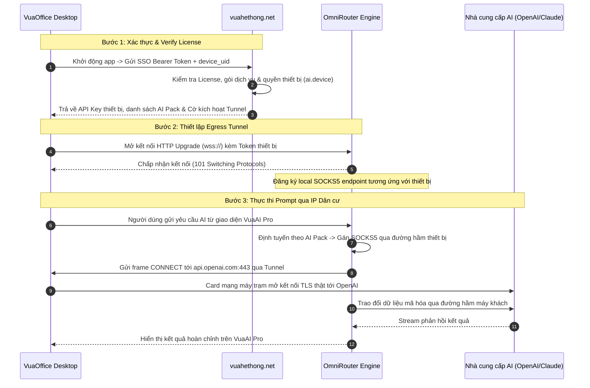

# TÀI LIỆU KIẾN TRÚC KỸ THUẬT: VUAOFFICE TUNNEL CORE
**Dự án:** Hệ sinh thái VuaOffice (`vuahethong.net` — `OmniRouter Engine` — `VuaOffice Desktop`)  
**Tài liệu:** Thiết kế chi tiết cơ chế Egress Tunnel cục bộ chống Mass-Ban  
**Mục tiêu:** Sử dụng 100% Core Native của VuaOffice (Node.js / Electron stdlib), không phụ thuộc thư viện bên thứ ba, mượn cổng ra mạng dân cư cục bộ để bảo vệ tài khoản AI.  
**Phiên bản:** v1.0  
**Ngày lập:** 2026-10-14  

---

## 1. PHÂN ĐỊNH RANH GIỚI 3 THÀNH PHẦN HỆ THỐNG

Theo đúng chỉ đạo kiến trúc của hệ thống 360 CORP, bài toán phân bổ và bảo vệ tài khoản AI được phân lập rõ ràng giữa 3 thành phần:

```text
+---------------------------------------------------------------------------------------+
|                                    1. VUAOFFICE DESKTOP                               |
|   (Bản quyền máy khách - Core Electron/Node.js Native - Không thêm lib thứ 3)        |
|                                                                                       |
|   - Soạn thảo văn bản, bảng tính, trình chiếu, xử lý tài liệu offline                 |
|   - Trợ lý VuaAI Pro tích hợp sẵn trong giao diện                                     |
|   - Chạy ngầm VuaOffice Tunnel Core: Cầu nối TCP Egress bằng IP mạng gia đình        |
+---------------------------------------------------------------------------------------+
                                  ▲                               ▲
      (1) Xác thực SSO            │                               │ (3) Reverse Tunnel
          & Verify License        │                               │     TCP Multiplexing
                                  ▼                               ▼
+-----------------------------------+   (2) Đồng bộ      +------------------------------+
|       2. VUA HỆ THỐNG             |       Chính sách   |     3. OMNIROUTER ENGINE     |
|     (vuahethong.net - Odoo 19)    |------------------->|   (Data Plane AI Gateway)    |
|                                   |                    |                              |
| - Giao diện kết nối tài khoản AI  |                    | - Lưu trữ cấu hình AI models |
| - Quản lý giấy phép & thiết bị    |                    |   & Combo định tuyến         |
| - Kiểm tra hạn mức, Quota & Token |                    | - SOCKS5 / Undici Dispatcher |
| - Cấp phát session & metadata     |                    | - TUYỆT ĐỐI GIỮ NGUYÊN CODE  |
+-----------------------------------+                    +------------------------------+
```

### 1.1 Khối Điều khiển: `vuahethong.net` (Control Plane)
* Đóng vai trò là trung tâm xác thực (SSO Authentication) và kiểm duyệt giấy phép (License Verification).
* Quản lý vòng đời thiết bị (`ai.device`) và các nhóm mô hình AI (`ai.pack`).
* Cung cấp endpoint cấu hình tập trung `GET /api/ai/v1/config`: kiểm tra thiết bị hợp lệ, cấp phát thông tin kết nối và định danh kích hoạt Tunnel.

### 1.2 Khối Định tuyến: `OmniRouter Engine` (Data Plane Gateway)
* Lưu giữ toàn bộ cấu hình các nhà cung cấp AI (OpenAI, Claude, Gemini, Antigravity) và các Combo/Pack định tuyến.
* **Nguyên tắc bất biến**: **Không đụng mã nguồn OmniRouter Engine**. OmniRouter đã có sẵn hệ thống phân giải proxy 4 cấp (`resolveProxyForConnection`) và API quản trị proxy tiêu chuẩn (`/api/v1/management/proxies`), hỗ trợ kết nối SOCKS5/HTTP qua Undici Dispatcher.

### 1.3 Khối Máy trạm: `VuaOffice Desktop Client` (Edge Tunnel Core)
* **Khai thác 100% Core Native**: Tận dụng triệt để các module có sẵn trong Node.js của Electron (`node:net`, `node:http`, `node:crypto`, `node:stream`).
* **Hạn chế tối đa thư viện bên thứ ba**: Không đóng gói thêm các binary phức tạp (không dùng Rathole bằng Rust, không dùng Frp/Gost bằng Go) để tránh phình dung lượng bộ cài và tránh lỗi cross-compile trên các hệ điều hành (macOS x64/arm64, Windows, Linux).
* Thiết lập kênh truyền TCP Egress ngược từ máy khách lên Gateway để các request AI đi ra Internet bằng chính IP dân cư thật của người dùng.

---

## 2. BÀI TOÁN MASS-BAN & CƠ CHẾ EGRESS CỤC BỘ

### 2.1 Nguy cơ Mass-Ban đối với Tài khoản AI Web Subscription
Khi sử dụng các tài khoản gói đăng ký cá nhân/doanh nghiệp (ChatGPT Plus/Team, Claude Pro, Gemini Advanced):
1. **Dải IP Datacenter bị gắn cờ**: Các hệ thống bảo vệ (Cloudflare Turnstile, Datadome) tự động phân loại dải IP của VPS thuộc ASN Hosting/Datacenter. Khi có lưu lượng lớn phát ra từ đây, hệ thống sẽ tự động chặn hoặc thu hồi token.
2. **Lệch vùng địa lý (Geo-Drift)**: Tài khoản đăng nhập ban đầu tại Việt Nam nhưng request lại phát từ server đặt tại nước ngoài, kích hoạt cơ chế phát hiện bất thường.
3. **Dồn tải trên một IP (Burst Concurrency)**: Việc hàng chục tài khoản cùng gửi request qua một địa chỉ IP máy chủ tạo dấu hiệu của bot cào tự động.

### 2.2 Cơ chế Egress Loopback (Mượn IP Dân cư của Khách)
* Thay vì request đi ra trực tiếp từ card mạng VPS, OmniRouter định tuyến request qua đường hầm xuống máy khách VuaOffice.
* Máy khách VuaOffice sử dụng card mạng gia đình thật (FPT, Viettel, VNPT) để kết nối tới máy chủ AI.
* **Bảo mật tuyệt đối**: Dữ liệu trao đổi giữa OmniRouter và nhà cung cấp AI được mã hóa TLS đầu-cuối. Máy khách chỉ đóng vai trò là ống dẫn byte TCP thô (`CONNECT`), hoàn toàn không thể giải mã hay đọc trộm phiên làm việc hoặc token bí mật.

---

## 3. THIẾT KẾ CHI TIẾT VUAOFFICE TUNNEL CORE (NATIVE CORE ONLY)

Nhằm tuân thủ nguyên tắc tối giản (Ponytail) và chỉ sử dụng core sẵn có của VuaOffice, module `TunnelCore` được thiết kế hoàn toàn bằng thư viện chuẩn của Node.js:

```text
VuaOffice Shell (Main Process)
└── apps/shell/src/main/tunnel/
    ├── tunnel-client.ts       (Kết nối HTTP Upgrade / WSS bằng node:https)
    ├── socket-multiplexer.ts   (Ghép kênh nhị phân bằng node:stream & node:crypto)
    └── egress-allowlist.ts     (Kiểm soát an toàn đích đến: chỉ cho phép AI domains)
```

### 3.1 Giao thức Đóng gói Khung Nhị phân (Binary Framing Protocol)
Sử dụng header 9-byte gọn nhẹ, không dùng thư viện ngoài:
```text
[1 byte: Type] [4 bytes: Stream ID (UInt32BE)] [4 bytes: Payload Length (UInt32BE)] [Payload]
```
* `Type 1 (CONNECT)`: Yêu cầu mở kết nối TCP tới đích (`host:port`).
* `Type 2 (DATA)`: Dữ liệu truyền tải giữa hai đầu socket.
* `Type 3 (CLOSE)`: Đóng một luồng kết nối cụ thể.
* `Type 4 (CONNECTED)`: Phản hồi kết nối thành công.
* `Type 5 (ERROR)`: Báo lỗi kết nối hoặc bị từ chối bởi allowlist.

### 3.2 Hàng rào Bảo vệ Máy trạm (Domain Allowlist Gate)
Để ngăn chặn việc máy khách bị lợi dụng làm proxy chuyển tiếp cho các mục đích ngoài ý muốn, `TunnelCore` trong VuaOffice cài đặt bộ lọc nghiêm ngặt:
* **Chỉ cho phép cổng 443 (HTTPS)**: Tuyệt đối từ chối cổng 80 hoặc các cổng nội bộ.
* **Chỉ cho phép các domain AI hợp lệ**:
  ```typescript
  const ALLOWED_AI_HOSTS = [
    /(^|\.)openai\.com$/,
    /(^|\.)chatgpt\.com$/,
    /(^|\.)anthropic\.com$/,
    /(^|\.)claude\.ai$/,
    /(^|\.)googleapis\.com$/,
    /(^|\.)generativelanguage\.googleapis\.com$/
  ]
  ```
* **Chặn IP trực tiếp**: Từ chối mọi yêu cầu kết nối trực tiếp đến IP thô (raw IP address) hoặc dải mạng nội bộ (RFC 1918: `10.x`, `192.168.x`, `127.x`).

---

## 4. QUY TRÌNH PHỐI HỢP GIỮA 3 THÀNH PHẦN



---

## 5. KẾ HOẠCH TRIỂN KHAI THEO CHUẨN 360 CORP

### Giai đoạn 1: Triển khai Tunnel Core Native trong VuaOffice
* Viết module `tunnel-client.ts` bên trong `apps/shell/src/main/` chỉ dùng Node.js stdlib.
* Tích hợp vào quy trình khởi động của Shell, tự động kích hoạt sau khi bắt tay thành công với `vuahethong.net`.
* Bổ sung cơ chế tự ngắt và kết nối lại thông minh khi máy tính sleep/wake hoặc thay đổi mạng Wi-Fi.

### Giai đoạn 2: Cập nhật Cấu hình trên `vuahethong.net`
* Bổ sung trường `tunnel_active` và metadata cổng ra trên model `ai.device`.
* Trả về cấu hình tunnel trong API `/api/ai/v1/config`.

### Giai đoạn 3: Kiểm thử Độc lập & Cổng Chất lượng `brand:gate`
* Chạy bộ kiểm thử tự động xác nhận IP ra ngoài qua dịch vụ kiểm tra IP (nhận đúng IP mạng dân cư).
* Chạy kiểm tra toàn diện 10 cổng `npm run brand:gate`.
* Đóng gói bản phát hành thử nghiệm nội bộ.

---

## 6. KẾT LUẬN

Giải pháp **VuaOffice Tunnel Core** đáp ứng trọn vẹn 3 yêu cầu của Sếp:
1. **Đúng vai trò 3 thành phần**: `vuahethong.net` quản lý xác thực & license; `OmniRouter Engine` giữ cấu hình định tuyến; `VuaOffice` mở tunnel lấy IP cục bộ.
2. **Tuyệt đối an toàn cho Router**: Không sửa đổi mã nguồn của OmniRouter Engine.
3. **Tiêu chuẩn mã nguồn tối giản**: Sử dụng 100% core sẵn có của VuaOffice, không thêm thư viện bên thứ ba, bảo đảm bộ cài nhẹ và không bao giờ gặp sự cố tương thích đa nền tảng.
